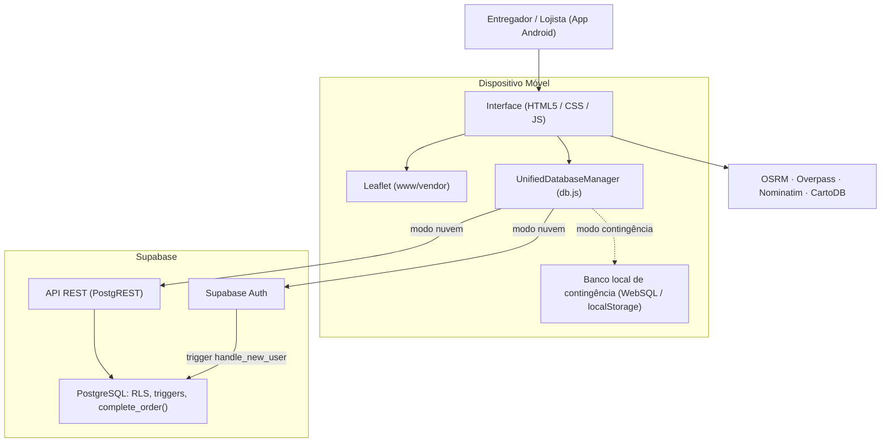

# MotoHelp

O MotoHelp é um aplicativo híbrido para Android de apoio a entregadores de moto e lojistas, desenvolvido como Trabalho de Conclusão de Curso (Tecnologia em Desenvolvimento de Sistemas). O repositório mantém o nome original, AppEntrega-TCC.

## Funcionalidades

* **Roteirização de múltiplas entregas:** matriz de tempos do OSRM, heurística do vizinho mais próximo e refinamento 2-Opt (ótimo local, sem garantia de ótimo global), com a rota desenhada no mapa a partir do GPS.
* **Portal de fretes:** o lojista publica um frete com código de entrega `ENT-XXXXXXXXXX`; o entregador consulta e aceita. Só um entregador consegue aceitar cada frete.
* **Confirmação por QR Code:** leitura pela câmera (jsQR) ou digitação. A entrega só é concluída com o código correto, pelo entregador do pedido, e a regra é validada no servidor (`complete_order`).
* **SOS mecânico:** postos, borracharias e oficinas reais do OpenStreetMap (Overpass) num raio de 5 km.
* **Manutenção e finanças da moto:** controle local no aparelho (`localStorage`).
* **Contingência local:** se o Supabase não estiver disponível ao abrir o app, ele funciona com um banco local de demonstração. **Não há sincronização** entre o banco local e a nuvem.

## Arquitetura de dados

O app não tem servidor próprio. O back-end é o Supabase (Auth, API REST e PostgreSQL), e a camada `www/db.js` (`UnifiedDatabaseManager`) concentra todo o acesso a dados.

1. **Nuvem (Supabase/PostgreSQL):** perfis, pedidos, histórico, cartões (somente máscara), locais salvos e auditoria. A segurança é declarada no banco (RLS, GRANT/REVOKE e triggers), valendo mesmo para chamadas diretas à API.
2. **Contingência local:** WebSQL quando disponível, senão `localStorage`. O modo é escolhido **uma única vez**, ao iniciar: se o SDK do Supabase carregou, as chaves existem e uma consulta de teste responde, o app usa a nuvem; senão, usa o banco local. Trata-se de um modelo "online com contingência local", não de offline-first.

As bibliotecas Leaflet e supabase-js estão copiadas em `www/vendor/`, então o app abre mesmo sem acesso a CDN. Mapas (tiles), rotas (OSRM), SOS (Overpass) e geocodificação (Nominatim) continuam exigindo internet.



## Regras de negócio no banco

* **Aceite (RN03):** o `UPDATE` de aceite só afeta pedidos `available` sem entregador (filtro no app + política RLS + trigger `enforce_order_rules`). Um segundo aceite não altera o pedido.
* **Conclusão (RN02):** a função `complete_order(p_order_id, p_qr_code)` bloqueia a linha (`SELECT ... FOR UPDATE`), confere entregador, status e QR Code, e só então marca `delivered`. Uma atualização direta para `delivered` é recusada pelo trigger, inclusive para o lojista.
* **Dados do pedido:** preço, endereços, cliente e pacote só podem ser alterados pelo lojista enquanto o pedido está disponível. Lojista, código de entrega e entregador não podem ser trocados.
* **Auditoria:** triggers `trg_audit_*` em `orders`, `users`, `cards` e `delivery_drivers` gravam `old_values`/`new_values` em JSONB na tabela `audit_logs`, que não aceita `UPDATE` nem `DELETE` de usuários. O app só pode inserir eventos com o próprio `user_id`.

## Segurança

* **RLS** em todas as tabelas, com políticas baseadas em `auth.uid()`. Cada usuário vê o próprio perfil e apenas a contraparte dos pedidos em que participa; cartões, locais e histórico são estritamente do dono.
* **Sem elevação de privilégio:** `WITH CHECK` impede que um usuário vire `admin`; o trigger de cadastro também ignora `user_type = admin`.
* **Menor privilégio:** o papel `anon` não acessa tabelas sensíveis; `authenticated` opera sob RLS.
* **Senhas:** na nuvem, ficam no Supabase Auth (bcrypt), fora de `public.users`. No banco local de contingência, são gravadas com PBKDF2-HMAC-SHA256 (salt aleatório, 100.000 iterações). Hashes legados (SHA-256 sem salt ou texto puro) são regravados no próximo login.
* **Saída escapada:** dados vindos do banco ou de APIs são escapados (`escapeHtml`) antes de entrar em `innerHTML`.
* **Código de entrega:** gerado com `crypto.getRandomValues` (10 dígitos) e único no banco.

## Estrutura do banco

Oito tabelas em `migrations/001_initial_schema.sql`: `users`, `delivery_drivers`, `merchants`, `orders`, `rides`, `cards`, `places` e `audit_logs`.

| Arquivo | Conteúdo |
| --- | --- |
| `migrations/001_initial_schema.sql` | Tabelas, chaves e índices |
| `migrations/002_enable_rls_and_policies.sql` | RLS e políticas |
| `migrations/003_audit_triggers.sql` | Auditoria automática |
| `migrations/004_permissions_and_grants.sql` | GRANT/REVOKE |
| `migrations/005_business_rules_hardening.sql` | Perfil por trigger, regras de pedido, `complete_order`, restrições de `users` e `audit_logs` |
| `schema.sql` | Concatenação das migrations 001 a 005 (não editar à mão) |
| `test_rls_security.sql` | 33 testes pgTAP de RLS, regras de pedido e auditoria |

## Tecnologias

* **Capacitor 8** (Android/WebView), **JavaScript ES6** sem framework, HTML5 e CSS3.
* **Leaflet 1.9.4** e tiles CartoDB/OpenStreetMap; **OSRM** (Route e Table); **Overpass** e **Nominatim**.
* **Supabase** (supabase-js v2): Auth, API REST e PostgreSQL.
* **jsQR 1.4.0** para leitura de QR Code.
* **pgTAP** para testes do banco; **Node.js** apenas para scripts auxiliares (`server.js` serve os arquivos em `localhost:3000`).

## Como executar

### Pré-requisitos

* Node.js.
* Android Studio, para gerar o `.apk`.
* Um projeto no Supabase (opcional: sem ele o app roda no modo de contingência local).

### Passos

1. Clone o repositório e instale as dependências:
   ```bash
   git clone https://github.com/MatheusHMBoaventura/AppEntrega-TCC.git
   cd AppEntrega-TCC
   npm install
   ```

2. No SQL Editor do Supabase, execute as migrations **em ordem**, de `001` a `005`.

3. Copie `www/supabase-config.example.js` para `www/supabase-config.js` e preencha a URL e a chave `anon` do projeto. Esse arquivo é ignorado pelo Git.

4. Para testar no navegador: `node server.js` e abra `http://localhost:3000`.

5. Para gerar o app Android:
   ```bash
   npx cap sync
   npx cap open android
   ```

### Testes do banco

Com as migrations aplicadas e a extensão pgTAP disponível, execute `test_rls_security.sql` (psql ou SQL Editor). O resultado esperado é `ok` nos 33 testes.

### Contas de demonstração (somente modo local)

No modo de contingência local, o app cria contas de demonstração com senha `123456`: `joao@email.com` (entregador) e `matheus@email.com` (lojista). Elas não existem no Supabase.

## Limitações conhecidas

* Sem sincronização entre o banco local e a nuvem.
* O login com Google só funciona no modo nuvem; no modo local, ele é simulado.
* O OSRM e o Overpass usados são servidores públicos, sem garantia de disponibilidade.
* Manutenção e finanças da moto ficam apenas no aparelho.

## Licença

Projeto acadêmico, licença ISC.
